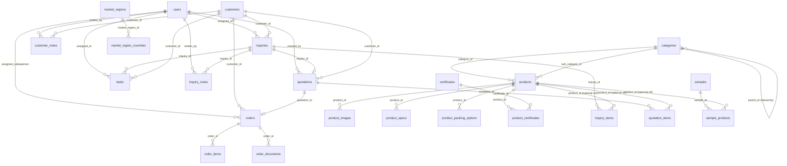

# database-design.md — PostgreSQL Relational Database Design

> **Engine:** PostgreSQL 16+  
> **ORM Layer:** Sequelize 6+ (Node.js ES Modules)  
> **Architecture:** Normalized Relational Core (3NF) + Pragmatic Hybrid JSONB (for polymorphic specifications)  
> **Application:** JHS GLOBAL — B2B Specialty Chemicals, Botanical Extracts, Nutraceuticals & Animal Feed Export Platform  

---

## 1. Executive Summary & Design Philosophy

As an enterprise B2B export platform, JHS GLOBAL requires strict data integrity, transactional guarantees (ACID), referential constraints, and auditability. International trade orders involve multi-thousand-dollar transactions, container shipments (FCL/LCL), regulatory trade documents (Phytosanitary, Certificate of Origin, Bill of Lading, COA, SDS), and multi-stage sales negotiation pipelines.

### Why PostgreSQL Replaces MongoDB:
1. **Relational Integrity & Foreign Keys:** Prevents orphaned records across Categories, Products, Quotations, Orders, and Customers.
2. **ACID Transactions:** Ensures multi-table operations (e.g. converting an Inquiry into a Quotation and creating Customer records) execute atomically.
3. **Advanced Indexing:** Native B-Tree, GIN, and Trigram (`pg_trgm`) indexes provide sub-millisecond lookups and fuzzy product catalogue searching without requiring third-party search engines.
4. **Hybrid Relational + JSONB Power:** Rigid relational structure for mission-critical trade data, combined with PostgreSQL's high-performance `JSONB` for category-specific polymorphic attributes (e.g. Active withanolides % in extracts vs. protein % in oil meals vs. active matter % in surfactants).

---

## 2. Entity Relationship Diagram (ERD)



---

## 3. Detailed Schema Specification

### 3.1 Authentication & Personnel: `users`
Administrative and sales team personnel managing the export operations.

| Column | Type | Constraints | Description |
| :--- | :--- | :--- | :--- |
| `id` | `INTEGER` | `PRIMARY KEY GENERATED ALWAYS AS IDENTITY` | Surrogate PK |
| `name` | `VARCHAR(100)` | `NOT NULL` | Full legal / business name |
| `email` | `VARCHAR(255)` | `NOT NULL UNIQUE` | Standardized lowercase email |
| `password` | `VARCHAR(255)` | `NOT NULL` | Bcrypt hashed credentials (cost factor 12) |
| `role` | `VARCHAR(20)` | `NOT NULL DEFAULT 'sales'` | Enum: `admin`, `sales`, `editor` |
| `is_active` | `BOOLEAN` | `NOT NULL DEFAULT TRUE` | Active account toggle |
| `last_login_at` | `TIMESTAMPTZ` | `DEFAULT NULL` | Last authenticated timestamp |
| `refresh_token_hash` | `TEXT` | `DEFAULT NULL` | Hashed active refresh token |
| `created_at` | `TIMESTAMPTZ` | `NOT NULL DEFAULT NOW()` | Record creation timestamp |
| `updated_at` | `TIMESTAMPTZ` | `NOT NULL DEFAULT NOW()` | Record update timestamp |

**Indexes:**
- `UNIQUE INDEX idx_users_email (email)`
- `INDEX idx_users_role_is_active (role, is_active)`

---

### 3.2 Catalogue Hierarchy: `categories`
Self-referencing tree supporting 3 levels of category nesting.

| Column | Type | Constraints | Description |
| :--- | :--- | :--- | :--- |
| `id` | `INTEGER` | `PRIMARY KEY GENERATED ALWAYS AS IDENTITY` | Primary Key |
| `name` | `VARCHAR(100)` | `NOT NULL` | E.g., "Personal Care Raw Materials" |
| `slug` | `VARCHAR(120)` | `NOT NULL UNIQUE` | URL-safe slug |
| `description` | `TEXT` | `DEFAULT ''` | Category summary |
| `parent_id` | `INTEGER` | `REFERENCES categories(id) ON DELETE SET NULL` | Parent category reference |
| `level` | `SMALLINT` | `NOT NULL DEFAULT 1 CHECK (level BETWEEN 1 AND 3)` | 1 = Master, 2 = Sub, 3 = Micro |
| `path` | `VARCHAR(255)` | `DEFAULT ''` | Breadcrumb path, e.g. `personal-care-raw-materials/surfactants-cleansing-agents` |
| `image_url` | `VARCHAR(500)` | `DEFAULT ''` | Banner / icon image URL |
| `image_alt` | `VARCHAR(255)` | `DEFAULT ''` | Image accessibility text |
| `icon` | `VARCHAR(100)` | `DEFAULT ''` | SVG/Lucide icon identifier |
| `hs_chapter` | `VARCHAR(10)` | `DEFAULT ''` | Harmonized System 2-digit chapter (e.g. `34`) |
| `order` | `INTEGER` | `NOT NULL DEFAULT 0` | UI sequence order |
| `is_active` | `BOOLEAN` | `NOT NULL DEFAULT TRUE` | Catalogue visibility toggle |
| `seo_title` | `VARCHAR(200)` | `DEFAULT ''` | SEO Title tag |
| `seo_description` | `VARCHAR(500)` | `DEFAULT ''` | SEO Meta description |
| `created_at` | `TIMESTAMPTZ` | `NOT NULL DEFAULT NOW()` | Record creation timestamp |
| `updated_at` | `TIMESTAMPTZ` | `NOT NULL DEFAULT NOW()` | Record update timestamp |

**Indexes:**
- `UNIQUE INDEX idx_categories_slug (slug)`
- `INDEX idx_categories_parent_order (parent_id, "order")`
- `INDEX idx_categories_is_active (is_active)`

---

### 3.3 Core Products Catalogue: `products`
The core export catalogue with product metadata and commercial export trade parameters.

| Column | Type | Constraints | Description |
| :--- | :--- | :--- | :--- |
| `id` | `INTEGER` | `PRIMARY KEY GENERATED ALWAYS AS IDENTITY` | Primary Key |
| `name` | `VARCHAR(200)` | `NOT NULL` | E.g. "Ashwagandha extract" |
| `slug` | `VARCHAR(250)` | `NOT NULL UNIQUE` | Unique URL identifier |
| `sku` | `VARCHAR(50)` | `DEFAULT ''` | Internal export SKU |
| `category_id` | `INTEGER` | `NOT NULL REFERENCES categories(id) ON DELETE RESTRICT` | Primary category |
| `sub_category_id` | `INTEGER` | `REFERENCES categories(id) ON DELETE SET NULL` | Subcategory |
| `short_description` | `VARCHAR(500)` | `DEFAULT ''` | Card / list preview text |
| `description` | `TEXT` | `DEFAULT ''` | Full specifications & processing description |
| `hs_code` | `VARCHAR(20)` | `DEFAULT NULL` | Optional verified 6-8 digit export HS Code (e.g. `1302.19`) |
| `availability` | `VARCHAR(50)` | `DEFAULT 'Year-round'` | Commercial availability: 'Year-round' or 'Seasonal' |
| `botanical_name` | `VARCHAR(150)` | `DEFAULT ''` | Scientific botanical nomenclature |
| `origin` | `JSONB` | `DEFAULT '["India"]'` | Array of origin regions (Gujarat, Kerala, etc.) |
| `forms` | `JSONB` | `DEFAULT '[]'` | Array: Whole, Powder, Cracked, Flakes |
| `grades` | `JSONB` | `DEFAULT '["Export Quality"]'` | Array: FAQ, ASTA, Extra Bold |
| `attributes` | `JSONB` | `DEFAULT '{}'` | Key/Value map for custom attributes |
| `moq_value` | `NUMERIC(10,2)` | `DEFAULT 1` | Minimum Order Quantity value |
| `moq_unit` | `VARCHAR(20)` | `DEFAULT '20ft FCL'` | MOQ Unit (MT, kg, FCL) |
| `shelf_life` | `VARCHAR(100)` | `DEFAULT '24 months'` | Shelf life guarantee |
| `storage` | `VARCHAR(255)` | `DEFAULT 'Store in cool dry place'` | Storage conditions |
| `incoterms` | `JSONB` | `DEFAULT '["FOB","CIF","CFR"]'` | Supported Incoterms |
| `ports` | `JSONB` | `DEFAULT '["Hazira (Surat)","Mundra"]'` | Preferred departure sea ports |
| `lead_time` | `VARCHAR(100)` | `DEFAULT '10–15 business days'` | Production and dispatch turnaround |
| `tags` | `JSONB` | `DEFAULT '[]'` | Keyword search tags |
| `is_featured` | `BOOLEAN` | `NOT NULL DEFAULT FALSE` | Homepage featured flag |
| `is_active` | `BOOLEAN` | `NOT NULL DEFAULT TRUE` | Active catalogue status |
| `is_private_label_available`| `BOOLEAN` | `NOT NULL DEFAULT TRUE` | OEM / Private label flag |
| `seo_title` | `VARCHAR(255)` | `DEFAULT ''` | Meta title |
| `seo_description` | `TEXT` | `DEFAULT ''` | Meta description |
| `seo_keywords` | `JSONB` | `DEFAULT '[]'` | Meta keyword tags |
| `view_count` | `INTEGER` | `NOT NULL DEFAULT 0` | Page hit counter |
| `created_at` | `TIMESTAMPTZ` | `NOT NULL DEFAULT NOW()` | Record creation timestamp |
| `updated_at` | `TIMESTAMPTZ` | `NOT NULL DEFAULT NOW()` | Record update timestamp |

**Indexes:**
- `UNIQUE INDEX idx_products_slug (slug)`
- `INDEX idx_products_category_active (category_id, is_active)`
- `INDEX idx_products_featured (is_featured)`
- `INDEX idx_products_hs_code (hs_code)`
- Full-Text Search GIN Index:
  ```sql
  CREATE INDEX idx_products_fts ON products 
  USING gin (to_tsvector('english', name || ' ' || short_description || ' ' || hs_code));
  ```

---

### 3.4 Product Normalized Child Tables & Hybrid JSONB Architecture

> **Architecture Design Note (Hybrid JSONB Storage):**  
> For sub-millisecond atomic read throughput on high-traffic Product Detail Pages (PDP), primary technical specifications, image gallery URLs, and packaging configurations are stored directly in structured JSONB attributes (`specs`, `images`, `packing`) on the `products` table. The normalized child tables defined below (`product_images`, `product_specs`, `product_packing_options`) remain part of the Sequelize database schema for relational integrity, backwards compatibility, and optional normalized analytical queries or third-party ERP synchronization.

#### `product_images`
| Column | Type | Constraints | Description |
| :--- | :--- | :--- | :--- |
| `id` | `INTEGER` | `PRIMARY KEY GENERATED ALWAYS AS IDENTITY` | Primary Key |
| `product_id` | `INTEGER` | `NOT NULL REFERENCES products(id) ON DELETE CASCADE` | Product FK |
| `url` | `VARCHAR(500)` | `NOT NULL` | CDN asset URL |
| `alt` | `VARCHAR(255)` | `DEFAULT ''` | Accessible description |
| `is_primary` | `BOOLEAN` | `NOT NULL DEFAULT FALSE` | Thumbnail image flag |
| `order` | `INTEGER` | `NOT NULL DEFAULT 0` | Carousel display order |

#### `product_specs`
| Column | Type | Constraints | Description |
| :--- | :--- | :--- | :--- |
| `id` | `INTEGER` | `PRIMARY KEY GENERATED ALWAYS AS IDENTITY` | Primary Key |
| `product_id` | `INTEGER` | `NOT NULL REFERENCES products(id) ON DELETE CASCADE` | Product FK |
| `key` | `VARCHAR(100)` | `NOT NULL` | E.g. "Withanolides Content", "Purity", "Moisture" |
| `value` | `VARCHAR(100)` | `NOT NULL` | E.g. "3.5% min", "≤ 10%" |
| `unit` | `VARCHAR(30)` | `DEFAULT ''` | E.g. "%", "mesh", "ppm" |

#### `product_packing_options`
| Column | Type | Constraints | Description |
| :--- | :--- | :--- | :--- |
| `id` | `INTEGER` | `PRIMARY KEY GENERATED ALWAYS AS IDENTITY` | Primary Key |
| `product_id` | `INTEGER` | `NOT NULL REFERENCES products(id) ON DELETE CASCADE` | Product FK |
| `type` | `VARCHAR(100)` | `NOT NULL` | E.g. "PP Bag", "HDPE Drum", "Vacuum Pack" |
| `size` | `VARCHAR(50)` | `NOT NULL` | E.g. "25 kg", "50 kg", "1 MT Jumbo Bag" |
| `notes` | `VARCHAR(255)` | `DEFAULT ''` | E.g. "Palletized with stretch film" |

#### `certificates` & `product_certificates` (M:N Junction)
| Column | Type | Constraints | Description |
| :--- | :--- | :--- | :--- |
| `product_id` | `INTEGER` | `NOT NULL REFERENCES products(id) ON DELETE CASCADE` | Product FK |
| `certificate_id` | `INTEGER` | `NOT NULL REFERENCES certificates(id) ON DELETE CASCADE` | Certificate FK |
| `PRIMARY KEY` | `(product_id, certificate_id)` | Compound PK | Prevents duplicates |

---

### 3.5 Customer CRM & Account Profiles: `customers`
B2B Buyer profiles synthesized from inquiries and trade transactions.

| Column | Type | Constraints | Description |
| :--- | :--- | :--- | :--- |
| `id` | `INTEGER` | `PRIMARY KEY GENERATED ALWAYS AS IDENTITY` | Primary Key |
| `company_name` | `VARCHAR(200)` | `NOT NULL` | Legal entity name |
| `contact_person` | `VARCHAR(150)` | `NOT NULL` | Primary procurement officer |
| `email` | `VARCHAR(255)` | `NOT NULL UNIQUE` | Official corporate email |
| `phone` | `VARCHAR(50)` | `DEFAULT ''` | Telephone number with country code |
| `whatsapp` | `VARCHAR(50)` | `DEFAULT ''` | Direct trade WhatsApp line |
| `country` | `VARCHAR(100)` | `NOT NULL` | Country of origin |
| `city` | `VARCHAR(100)` | `DEFAULT ''` | Port/City of operation |
| `website` | `VARCHAR(255)` | `DEFAULT ''` | Corporate URL |
| `business_type` | `VARCHAR(50)` | `DEFAULT 'importer'` | Importer, Distributor, Manufacturer |
| `interested_products` | `JSONB` | `DEFAULT '[]'` | Product categories of interest |
| `total_order_value` | `NUMERIC(14,2)` | `NOT NULL DEFAULT 0.00` | Lifetime settled order value |
| `currency` | `VARCHAR(10)` | `NOT NULL DEFAULT 'USD'` | Currency |
| `preferred_port` | `VARCHAR(150)` | `DEFAULT ''` | Destination discharge port |
| `preferred_incoterm` | `VARCHAR(20)` | `DEFAULT 'CIF'` | Preferred trade term |
| `payment_terms` | `VARCHAR(200)` | `DEFAULT '30% Advance TT'` | Default commercial terms |
| `shipping_preference`| `VARCHAR(100)` | `DEFAULT 'FCL Standard 20ft'`| Container preferences |
| `assigned_salesperson`| `INTEGER` | `REFERENCES users(id) ON DELETE SET NULL` | Account executive |
| `last_contact_date` | `TIMESTAMPTZ` | `DEFAULT NOW()` | Date of last touchpoint |
| `created_at` | `TIMESTAMPTZ` | `NOT NULL DEFAULT NOW()` | Record creation timestamp |
| `updated_at` | `TIMESTAMPTZ` | `NOT NULL DEFAULT NOW()` | Record update timestamp |

**Indexes:**
- `UNIQUE INDEX idx_customers_email (email)`
- `INDEX idx_customers_country (country)`
- `INDEX idx_customers_assigned_salesperson (assigned_salesperson)`

---

### 3.6 Inquiries / RFQs: `inquiries` & `inquiry_items`
Primary lead generation mechanism. Stores buyer specifications, shipping demands, and AI scoring metrics.

#### `inquiries` Table
| Column | Type | Constraints | Description |
| :--- | :--- | :--- | :--- |
| `id` | `INTEGER` | `PRIMARY KEY GENERATED ALWAYS AS IDENTITY` | Primary Key |
| `reference_no` | `VARCHAR(50)` | `NOT NULL UNIQUE` | Human-readable: `RFQ-YYYY-XXXXXX` |
| `customer_id` | `INTEGER` | `REFERENCES customers(id) ON DELETE SET NULL` | Linked customer |
| `buyer_name` | `VARCHAR(150)` | `NOT NULL` | Contact name |
| `buyer_email` | `VARCHAR(255)` | `NOT NULL` | Contact email |
| `buyer_phone` | `VARCHAR(50)` | `DEFAULT ''` | Phone |
| `buyer_whatsapp` | `VARCHAR(50)` | `DEFAULT ''` | WhatsApp |
| `buyer_company` | `VARCHAR(200)` | `NOT NULL` | Company name |
| `buyer_designation` | `VARCHAR(100)` | `DEFAULT ''` | Title |
| `buyer_website` | `VARCHAR(255)` | `DEFAULT ''` | Website |
| `buyer_country` | `VARCHAR(100)` | `NOT NULL` | Country |
| `buyer_city` | `VARCHAR(100)` | `DEFAULT ''` | City |
| `buyer_type` | `VARCHAR(50)` | `DEFAULT 'importer'` | Business category |
| `destination_port` | `VARCHAR(150)` | `DEFAULT ''` | Target discharge port |
| `incoterm` | `VARCHAR(20)` | `DEFAULT 'CIF'` | FOB, CIF, CFR, etc. |
| `target_shipment_month`| `VARCHAR(50)` | `DEFAULT ''` | Shipment window |
| `payment_term` | `VARCHAR(50)` | `DEFAULT 'TT'` | TT, LC, CAD |
| `needs_private_label`| `BOOLEAN` | `NOT NULL DEFAULT FALSE` | Private label packaging required |
| `needs_sample` | `BOOLEAN` | `NOT NULL DEFAULT FALSE` | Sample batch requested |
| `message` | `TEXT` | `DEFAULT ''` | Buyer notes and specifications |
| `attachments` | `JSONB` | `DEFAULT '[]'` | Uploaded RFQ documents / LOI |
| `status` | `VARCHAR(50)` | `NOT NULL DEFAULT 'new'` | Pipeline stage |
| `priority` | `VARCHAR(20)` | `NOT NULL DEFAULT 'warm'` | `hot`, `warm`, `cold` |
| `assigned_to` | `INTEGER` | `REFERENCES users(id) ON DELETE SET NULL` | Assigned salesperson |
| `ai_summary` | `TEXT` | `DEFAULT ''` | AI generated 3-line RFQ brief |
| `ai_language` | `VARCHAR(10)` | `DEFAULT 'en'` | Buyer language code |
| `ai_translated_message`| `TEXT` | `DEFAULT ''` | English translation |
| `ai_extracted` | `JSONB` | `DEFAULT '{}'` | Structured extracted specs |
| `ai_lead_score` | `INTEGER` | `DEFAULT 50` | 0 - 100 Lead viability score |
| `ai_score_reason` | `TEXT` | `DEFAULT ''` | Justification for score |
| `ai_suggested_reply` | `TEXT` | `DEFAULT ''` | Drafted sales proposal email |
| `email_sent_buyer` | `BOOLEAN` | `NOT NULL DEFAULT FALSE` | Auto-acknowledgement flag |
| `email_sent_team` | `BOOLEAN` | `NOT NULL DEFAULT FALSE` | Internal notification flag |
| `created_at` | `TIMESTAMPTZ` | `NOT NULL DEFAULT NOW()` | Record creation timestamp |
| `updated_at` | `TIMESTAMPTZ` | `NOT NULL DEFAULT NOW()` | Record update timestamp |

**Indexes:**
- `UNIQUE INDEX idx_inquiries_ref (reference_no)`
- `INDEX idx_inquiries_status_created (status, created_at DESC)`
- `INDEX idx_inquiries_assigned_status (assigned_to, status)`
- `INDEX idx_inquiries_buyer_email (buyer_email)`
- `INDEX idx_inquiries_buyer_country (buyer_country)`

#### `inquiry_items` Table
| Column | Type | Constraints | Description |
| :--- | :--- | :--- | :--- |
| `id` | `INTEGER` | `PRIMARY KEY GENERATED ALWAYS AS IDENTITY` | Primary Key |
| `inquiry_id` | `INTEGER` | `NOT NULL REFERENCES inquiries(id) ON DELETE CASCADE`| Inquiry FK |
| `product_id` | `INTEGER` | `REFERENCES products(id) ON DELETE SET NULL` | Catalogue reference (optional) |
| `product_name` | `VARCHAR(200)` | `NOT NULL` | Immutable product name snapshot |
| `quantity` | `NUMERIC(12,2)` | `NOT NULL` | Requested quantity |
| `unit` | `VARCHAR(30)` | `NOT NULL DEFAULT 'MT'` | MT, kg, 20ft FCL, 40ft FCL |
| `packing` | `VARCHAR(100)` | `DEFAULT ''` | Packing specification |
| `form` | `VARCHAR(50)` | `DEFAULT ''` | Form (Whole, Powder, etc.) |
| `grade` | `VARCHAR(50)` | `DEFAULT ''` | Quality grade |

---

### 3.7 Commercial Quotations: `quotations` & `quotation_items`

#### `quotations` Table
| Column | Type | Constraints | Description |
| :--- | :--- | :--- | :--- |
| `id` | `INTEGER` | `PRIMARY KEY GENERATED ALWAYS AS IDENTITY` | Primary Key |
| `quotation_number` | `VARCHAR(50)` | `NOT NULL UNIQUE` | Official quote reference `QT-YYYY-XXXXXX` |
| `inquiry_id` | `INTEGER` | `REFERENCES inquiries(id) ON DELETE SET NULL` | Originating inquiry |
| `customer_id` | `INTEGER` | `REFERENCES customers(id) ON DELETE SET NULL` | Linked customer profile |
| `buyer_name` | `VARCHAR(150)` | `NOT NULL` | Buyer contact |
| `buyer_email` | `VARCHAR(255)` | `NOT NULL` | Buyer email |
| `buyer_company` | `VARCHAR(200)` | `NOT NULL` | Buyer entity |
| `buyer_country` | `VARCHAR(100)` | `NOT NULL` | Destination country |
| `buyer_phone` | `VARCHAR(50)` | `DEFAULT ''` | Phone |
| `buyer_address` | `TEXT` | `DEFAULT ''` | Billing address |
| `currency` | `VARCHAR(10)` | `NOT NULL DEFAULT 'USD'` | Trade currency |
| `subtotal` | `NUMERIC(14,2)` | `NOT NULL DEFAULT 0.00` | Commodity subtotal |
| `shipping_charges` | `NUMERIC(14,2)` | `NOT NULL DEFAULT 0.00` | Ocean / Air freight charges |
| `insurance_charges`| `NUMERIC(14,2)` | `NOT NULL DEFAULT 0.00` | Marine transit insurance |
| `other_charges` | `NUMERIC(14,2)` | `NOT NULL DEFAULT 0.00` | Certification / inspection charges |
| `total_amount` | `NUMERIC(14,2)` | `NOT NULL DEFAULT 0.00` | Final commercial total |
| `incoterm` | `VARCHAR(20)` | `NOT NULL DEFAULT 'CIF'` | Trade term |
| `port_of_loading` | `VARCHAR(150)` | `DEFAULT 'Hazira Port / Mundra Port, Gujarat, India'` | Departure port |
| `port_of_discharge`| `VARCHAR(150)` | `DEFAULT ''` | Destination port |
| `payment_terms` | `VARCHAR(255)` | `DEFAULT '30% Advance TT, 70% against BL copy'`| Agreed terms |
| `validity_date` | `TIMESTAMPTZ` | `NOT NULL` | Price expiry date |
| `delivery_time` | `VARCHAR(100)` | `DEFAULT '15-20 business days post order confirmation'`| ETA |
| `status` | `VARCHAR(30)` | `NOT NULL DEFAULT 'draft'` | `draft`, `sent`, `negotiation`, `accepted`, `rejected`, `expired` |
| `notes` | `TEXT` | `DEFAULT ''` | Special stipulations |
| `created_by` | `INTEGER` | `REFERENCES users(id) ON DELETE SET NULL` | Prepared by |
| `created_at` | `TIMESTAMPTZ` | `NOT NULL DEFAULT NOW()` | Record creation timestamp |
| `updated_at` | `TIMESTAMPTZ` | `NOT NULL DEFAULT NOW()` | Record update timestamp |

**Indexes:**
- `UNIQUE INDEX idx_quotations_number (quotation_number)`
- `INDEX idx_quotations_status_created (status, created_at DESC)`
- `INDEX idx_quotations_customer (customer_id)`

#### `quotation_items` Table
| Column | Type | Constraints | Description |
| :--- | :--- | :--- | :--- |
| `id` | `INTEGER` | `PRIMARY KEY GENERATED ALWAYS AS IDENTITY` | Primary Key |
| `quotation_id` | `INTEGER` | `NOT NULL REFERENCES quotations(id) ON DELETE CASCADE`| Quotation FK |
| `product_id` | `INTEGER` | `REFERENCES products(id) ON DELETE SET NULL` | Product FK |
| `product_name` | `VARCHAR(200)` | `NOT NULL` | Snapshot name |
| `specification` | `TEXT` | `DEFAULT ''` | Exact grade / quality parameters |
| `quantity` | `NUMERIC(12,2)` | `NOT NULL` | Volume |
| `unit` | `VARCHAR(30)` | `NOT NULL DEFAULT 'MT'` | Unit |
| `unit_price` | `NUMERIC(14,2)` | `NOT NULL` | Price per unit |
| `total` | `NUMERIC(14,2)` | `NOT NULL` | Line total (`quantity * unit_price`) |

---

### 3.8 Export Orders & Shipment Documentation: `orders`

#### `orders` Table
| Column | Type | Constraints | Description |
| :--- | :--- | :--- | :--- |
| `id` | `INTEGER` | `PRIMARY KEY GENERATED ALWAYS AS IDENTITY` | Primary Key |
| `order_number` | `VARCHAR(50)` | `NOT NULL UNIQUE` | Official export order `ORD-YYYY-XXXXXX` |
| `quotation_id` | `INTEGER` | `REFERENCES quotations(id) ON DELETE SET NULL` | Preceding quote |
| `inquiry_id` | `INTEGER` | `REFERENCES inquiries(id) ON DELETE SET NULL` | Originating RFQ |
| `customer_id` | `INTEGER` | `REFERENCES customers(id) ON DELETE SET NULL` | Customer account |
| `buyer_name` | `VARCHAR(150)` | `NOT NULL` | Buyer contact |
| `buyer_email` | `VARCHAR(255)` | `NOT NULL` | Buyer email |
| `buyer_company` | `VARCHAR(200)` | `NOT NULL` | Buyer company |
| `buyer_country` | `VARCHAR(100)` | `NOT NULL` | Country |
| `buyer_phone` | `VARCHAR(50)` | `DEFAULT ''` | Phone |
| `buyer_address` | `TEXT` | `DEFAULT ''` | Delivery address |
| `currency` | `VARCHAR(10)` | `NOT NULL DEFAULT 'USD'` | Order currency |
| `total_amount` | `NUMERIC(14,2)` | `NOT NULL` | Contract value |
| `incoterm` | `VARCHAR(20)` | `NOT NULL DEFAULT 'CIF'` | Trade term |
| `payment_terms` | `VARCHAR(255)` | `DEFAULT '30% Advance TT, 70% against BL copy'`| Payment milestones |
| `shipping_method` | `VARCHAR(50)` | `DEFAULT 'Ocean FCL'` | Ocean FCL, LCL, Air Cargo |
| `destination_port` | `VARCHAR(150)` | `DEFAULT ''` | Destination discharge port |
| `expected_shipment_date`| `TIMESTAMPTZ` | `DEFAULT NULL` | Scheduled dispatch |
| `order_status` | `VARCHAR(50)` | `NOT NULL DEFAULT 'confirmed'` | `confirmed`, `processing`, `ready_for_shipment`, `shipped`, `in_transit`, `delivered`, `completed`, `cancelled` |
| `assigned_salesperson`| `INTEGER` | `REFERENCES users(id) ON DELETE SET NULL` | Order supervisor |
| `container_number` | `VARCHAR(50)` | `DEFAULT ''` | Shipping container # (e.g. `MSCU1234567`) |
| `shipping_line` | `VARCHAR(100)` | `DEFAULT ''` | Maersk, MSC, Hapag-Lloyd |
| `port_of_loading` | `VARCHAR(150)` | `DEFAULT 'Hazira Port / Mundra Port, Gujarat'` | Departure port |
| `port_of_discharge`| `VARCHAR(150)` | `DEFAULT ''` | Destination port |
| `etd` | `TIMESTAMPTZ` | `DEFAULT NULL` | Estimated Departure Date |
| `eta` | `TIMESTAMPTZ` | `DEFAULT NULL` | Estimated Arrival Date |
| `bill_of_lading_number`| `VARCHAR(100)` | `DEFAULT ''` | B/L Master tracking number |
| `tracking_url` | `VARCHAR(500)` | `DEFAULT ''` | Carrier web tracking URL |
| `shipping_status` | `VARCHAR(50)` | `DEFAULT 'pending'` | `booked`, `loaded`, `at_sea`, `arrived_at_port`, `customs_cleared`, `delivered`, `pending` |
| `notes` | `TEXT` | `DEFAULT ''` | Operational notes |
| `created_at` | `TIMESTAMPTZ` | `NOT NULL DEFAULT NOW()` | Record creation timestamp |
| `updated_at` | `TIMESTAMPTZ` | `NOT NULL DEFAULT NOW()` | Record update timestamp |

**Indexes:**
- `UNIQUE INDEX idx_orders_number (order_number)`
- `INDEX idx_orders_status_created (order_status, created_at DESC)`
- `INDEX idx_orders_customer (customer_id)`
- `INDEX idx_orders_bl_number (bill_of_lading_number)`

#### `order_items` Table
| Column | Type | Constraints | Description |
| :--- | :--- | :--- | :--- |
| `id` | `INTEGER` | `PRIMARY KEY GENERATED ALWAYS AS IDENTITY` | Primary Key |
| `order_id` | `INTEGER` | `NOT NULL REFERENCES orders(id) ON DELETE CASCADE` | Order FK |
| `product_id` | `INTEGER` | `REFERENCES products(id) ON DELETE SET NULL` | Product FK |
| `product_name` | `VARCHAR(200)` | `NOT NULL` | Commodity name |
| `specification` | `TEXT` | `DEFAULT ''` | Physical specifications |
| `quantity` | `NUMERIC(12,2)` | `NOT NULL` | Contract volume |
| `unit` | `VARCHAR(30)` | `NOT NULL DEFAULT 'MT'` | Unit |
| `unit_price` | `NUMERIC(14,2)` | `NOT NULL` | Price per unit |
| `total` | `NUMERIC(14,2)` | `NOT NULL` | Subtotal |

#### `order_documents` Table (Export Documentation)
| Column | Type | Constraints | Description |
| :--- | :--- | :--- | :--- |
| `id` | `INTEGER` | `PRIMARY KEY GENERATED ALWAYS AS IDENTITY` | Primary Key |
| `order_id` | `INTEGER` | `NOT NULL REFERENCES orders(id) ON DELETE CASCADE` | Order FK |
| `document_type` | `VARCHAR(100)` | `NOT NULL` | Commercial Invoice, Packing List, BL, Certificate of Origin, Phytosanitary, COA |
| `document_number` | `VARCHAR(100)` | `DEFAULT ''` | Official certificate # |
| `file_name` | `VARCHAR(255)` | `NOT NULL` | Display filename |
| `file_url` | `VARCHAR(500)` | `NOT NULL` | Secure cloud storage URL |
| `uploaded_at` | `TIMESTAMPTZ` | `NOT NULL DEFAULT NOW()` | Timestamp |

---

### 3.9 Supporting Modules

#### `sample_requests` & `sample_products`
Records for pre-shipment buyer sample approvals.
- `sample_requests`: `id`, `reference_no`, `buyer_name`, `buyer_email`, `buyer_company`, `buyer_phone`, `buyer_country`, `shipping_street`, `shipping_city`, `shipping_state`, `shipping_postal_code`, `shipping_country`, `courier_provider` (DHL/FedEx), `courier_account_number`, `testing_parameters`, `status` (`new`, `approved`, `dispatched`, `delivered`, `rejected`), `tracking_no`, timestamps.
- `sample_products`: `id`, `sample_id` (FK), `product_id` (FK nullable), `product_name`, `qty` (e.g. "250g").

#### `blog_posts`
Trade insights, market crop reports, and QA compliance articles.
- `id`, `title`, `slug` (UNIQUE), `excerpt`, `content` (TEXT), `cover_image_url`, `cover_image_alt`, `author_name`, `author_designation`, `author_avatar`, `tags` (JSONB), `category`, `status` (`draft`, `published`), `published_at`, `read_minutes`, `seo_title`, `seo_description`, `seo_keywords` (JSONB), timestamps.
- **Index:** `to_tsvector('english', title || ' ' || excerpt || ' ' || content)` for article search.

#### `testimonials`
Verified buyer testimonials for global trust.
- `id`, `name`, `designation`, `company`, `country`, `flag`, `text`, `rating` (1-5), `avatar_url`, `is_active`, `order`, timestamps.

#### `market_regions` & `market_region_countries`
Global trade corridors and destination transit benchmarks.
- `market_regions`: `id`, `region` (e.g. "Middle East & GCC"), `description`, `transit_days`, `order`, `is_active`, timestamps.
- `market_region_countries`: `id`, `market_region_id` (FK), `name`, `code` (ISO 2-letter), `flag`, `ports` (JSONB).

#### `faqs`
B2B frequently asked questions (MOQ, Incoterms, LC payment, QC).
- `id`, `question`, `answer`, `group`, `order`, `is_active`, timestamps.

#### `tasks`
Sales pipeline internal Kanban follow-ups.
- `id`, `title`, `task_type` (`call`, `whatsapp`, `email`, `meeting`, `review`, `document`), `inquiry_id` (FK nullable), `inquiry_reference`, `customer_id` (FK nullable), `customer_name`, `company`, `country`, `due_date`, `due_time`, `priority` (`high`, `medium`, `low`), `status` (`pending`, `completed`, `cancelled`), `assigned_to` (FK nullable to users), `notes`, `completed_at`, timestamps.

#### `ai_usage_logs` & `embeddings`
Token analytics and semantic RAG store.
- `ai_usage_logs`: `id`, `feature`, `model`, `input_tokens`, `output_tokens`, `latency_ms`, `success`, `error`, `cost_estimate`, `user_id` (FK nullable), `ip_hash`, `cached`, `at`.
- `embeddings`: `id`, `source_type` (`product`, `faq`, `certificate`, `blog`), `source_id` (INTEGER), `chunk_text`, `chunk_index`, `vector` (JSONB or `vector` extension if pgvector installed), `hash`, `metadata` (JSONB), `updated_at`.

---

## 4. Normalization Strategy & Decisions

| MongoDB Pattern | PostgreSQL 3NF Conversion | Architectural Benefit |
| :--- | :--- | :--- |
| `buyer` subdocument in Inquiry | Flattened columns (`buyer_name`, `buyer_company`, etc.) + linked to `customers(id)` | Fast relational queries without unnesting; maintains exact snapshot while building CRM history |
| `items[]` in Inquiry/Quote/Order | Dedicated child tables (`inquiry_items`, `quotation_items`, `order_items`) | Accurate aggregate calculations (`SUM`, `AVG`), relational integrity, line-item status tracking |
| `documents[]` in Order | `order_documents` child table | Independent file auditing, strict document typing, granular uploads and deletions |
| `certificateIds[]` on Product | `product_certificates` M:N Junction table | Standard relational joins; allows querying all products certified by FSSAI Central License or APEDA instantly |
| `specs[]` on Product | `product_specs` child table | Normalizes technical parameters (Active Assay, Moisture, Mesh Size, Purity) for parameter-based search |
| `countries[]` in MarketRegion | `market_region_countries` table | Enables searching export destinations by ISO code or port |
| Flexible tags / origin arrays | `JSONB` with GIN indexing | High performance without schema bloat for non-relational tags and ports |

---

## 5. Backward Compatibility Layer (`id` vs `_id`)

The client SPA interface interacts with records using `_id` and `id`. To guarantee 100% zero-regression compatibility without requiring any frontend refactoring:

1. **Virtual Attribute on Models:** Every Sequelize model exposes `_id` as a virtual getter returning `this.id`.
2. **Global Serializer in `apiResponse.js`:** All responses automatically serialize models, ensuring both `id` and `_id` are always present on output JSON objects.
3. **Numeric Parameter Handling:** Controllers and validation middlewares parse route params using `parseInt(id, 10)` rather than MongoDB ObjectId regexes.

---

## 6. Advanced Relational Engineering Patterns

### 6.1 ACID Transaction & Idempotency for RFQ Creation
The RFQ submission flow writes to `inquiries`, `inquiry_items`, and updates/links `customers`. To prevent partial records or duplicate submissions:
- **Transaction Scope:** Handled via `sequelize.transaction(async (t) => { ... })`. If item creation or email queue dispatch fails, the transaction automatically rolls back.
- **Reference Number Sequence:** Generated using a formatted sequence `RFQ-YYYY-XXXXXX` from a dedicated PostgreSQL sequence (`CREATE SEQUENCE rfq_reference_seq START 100001`).
- **Idempotency Key:** Client passes `Idempotency-Key: <UUID>` header. Stored in `inquiries.idempotency_key` with a `UNIQUE` partial constraint. If a duplicate submission is received within 24 hours, the existing record is returned without re-processing.
- **Data Snapshots:** Product names, packaging specs, and units are snapshotted directly into `inquiry_items` and `quotation_items` so that future catalogue edits do not alter historical contractual records.

### 6.2 Expiry & Scheduled Cleanup Jobs (Replacing Mongo TTL)
MongoDB TTL indexes are replaced with a scheduled PostgreSQL cleanup job (executed via `pg_cron` or backend `node-cron` worker):
```sql
-- Nightly cleanup of temporary chat sessions older than 30 days
DELETE FROM ai_usage_logs WHERE at < NOW() - INTERVAL '90 days' AND success = true;
-- Nightly purge of expired rate-limit buckets and unverified drafts
DELETE FROM inquiries WHERE status = 'draft' AND created_at < NOW() - INTERVAL '14 days';
```

### 6.3 Connection Pooling & Performance Tuning
- **Sequelize Pool Configuration:**
  - `max`: 20 connections per API instance.
  - `min`: 5 idle connections.
  - `acquire`: 30,000 ms.
  - `idle`: 10,000 ms.
- **Search Optimization:**
  - `pg_trgm` extension enables trigram similarity search (`SIMILARITY(name, :query) > 0.3`).
  - `tsvector` + GIN indexing enables instant keyword full-text search across commodity titles and descriptions.
- **Embeddings:** `pgvector` extension with an HNSW index (`CREATE INDEX ON embeddings USING hnsw (vector vector_cosine_ops)`) provides vector similarity search for grounded LLM responses.

### 6.4 Backups & Point-In-Time Recovery (PITR)
- **Daily Full Backups:** Automated `pg_dump -Fc` compressed snapshots uploaded to encrypted private S3 storage.
- **Continuous Archiving:** Write-Ahead Logging (WAL) archiving enabled for continuous Point-In-Time Recovery (PITR) down to the second.
- **Zero-Downtime Migration Standard:** Schema migrations use additive changes, non-blocking index creation (`CREATE INDEX CONCURRENTLY`), and phased column deprecation.

---

## 7. Migration & Seeding Execution

```bash
# 1. Start PostgreSQL 16 Alpine container
docker compose up -d postgres

# 2. Sync database schema (Sequelize auto-syncs models in dev)
cd server && npm run dev

# 3. Seed master catalogue (4 divisions, 18 subcategories, 115 active export commodities)
cd server && npm run seed
```
